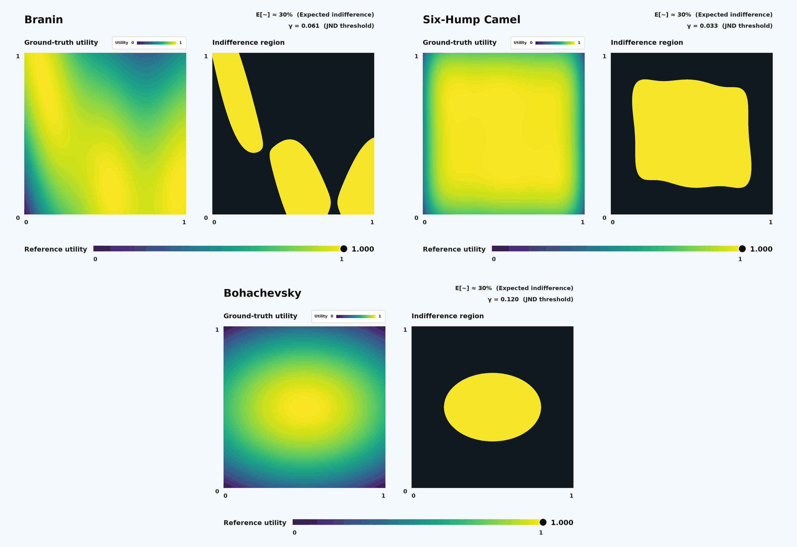

# Consecutive Preferential Bayesian Optimization (CPBO)

**Published in Transactions on Machine Learning Research (TMLR), 2026.**

**Paper:** [TMLR / OpenReview](https://openreview.net/forum?id=R1ac8MpBt4) | [arXiv](https://arxiv.org/abs/2511.05163)

This repository accompanies our paper on **preferential Bayesian optimization** in settings where producing new candidates is costly and users may be unable to distinguish between similar options. It includes the **CPBO implementation**, adapted baselines, benchmark functions, and tools for running and evaluating experiments.

---

## Learning from consecutive comparisons

CPBO searches for better candidates by comparing each new candidate with the previous one, reducing the need to produce two new candidates for every query. It also accounts for comparisons where the user cannot tell the candidates apart, learning a just-noticeable difference (JND) threshold alongside the utility model to guide the search.



*Yellow highlights candidates that the oracle would perceive as equally preferable to the reference candidate because their utility difference falls within the JND threshold. The region changes as the reference utility moves, while the threshold stays fixed for each function. Each threshold is chosen so that approximately 30% of uniformly sampled candidate pairs are judged indifferent.*

A [visualization of remaining benchmark functions](gifs/all_seven_func.gif) is also available.

---

## 📁 Folder Overview

```
.
├── baselines/           # Baseline algorithms code. Follow README.md there
├── environment/         # Environment installation materials
├── results/             # Output results, logs, and plots
├── start_points/        # Initialization data for CPBO
├── acquisition.py       # Acquisition function
├── cli.py               # Command-line interface
├── config.py            # Central configuration class for managing experiments
├── CPBO_runner.py       # --> MAIN SCRIPT TO EXECUTE CPBO
├── evaluation.py        # Evaluation metrics and ranking calculations
├── likelihood.py        # JND Likelihood functions
├── model.py             # GP model definitions
├── oracle.py            # JND Oracle
├── train.py             # Training loops
├── utility_functions.py # Utility functions
└── utils.py             # Helper functions
```

---

## ⚙️ Environment Setup

To set up the environment used for running all experiments:

1. **Navigate to the `environment/` folder**:

```bash
cd environment
```

2. **Create the CPBO conda environment** using the provided YAML file:

```bash
conda env create -f environment.yml
```

3. **Activate the environment**:

```bash
conda activate CPBO
```

`environment.yml` file can be inspected to view the full list of dependencies.
While exact versions are not strictly required, the ones specified reflect the versions used to run all experiments in this work.

---

## 📊 Running Experiments

All experiments are executed through `CPBO_runner.py`, which executes model training, evaluations, and result logging.

There are two main ways to configure experiments: (1) **Static Parameters** defined in the `Config` class inside `config.py`. These serve as the default values and can be edited directly for persistent changes.
(2) **Command-Line Arguments** defined in `cli.py` using `argparse`. These override the defaults from `config.py` at runtime.

### To Run the Default Experiment

Simply execute:

```bash
python CPBO_runner.py
```

This will run the default configuration defined in `cli.py`.

### Custom Experiment with Arguments

To run CPBO with a **trainable JND parameter**, optimizing the **Branin function** for **30 BO steps**, run:

```bash
python CPBO_runner.py --seed-value 1 --data-gamma 0.04 --bool-model-gamma yes --model-iteration 2000 --bo-init 10 --bo-optim 25 --function-name branin --total-steps 30
```

**--seed-value** argument can be increased to generate different initialization points or to control randomness across repeated runs. All experiment outputs, including logs and results, will be saved in the **results/** folder by default.

### Batch Execution on Cluster (Optional)

To run a large number of experiments efficiently (e.g., across multiple seeds), we use a batch script submission tool `sbatch_commandlist`. This reads commands from a CSV and submits jobs in parallel:

```bash
sbatch_commandlist --max_jobs 30 -t 03:00:00 -mem 10000 -c 4 run_experiments.csv
```

Each line in the CSV contains a shell command below with an incrementing seed value:

```bash
conda activate CPBO python -u CPBO_runner.py --seed-value 1 --data-gamma 0.04 --bool-model-gamma 'yes' --model-iteration 2000 --bo-init 10 --bo-optim 25 --function-name branin > logs/branin/exp1.out
```
